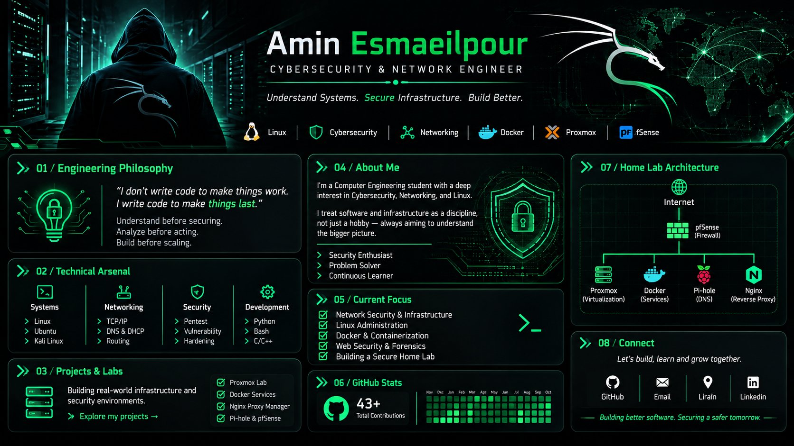

# 🛡️ Amin Esmailpour

  

<h3 align="center">
  Cybersecurity Enthusiast | Linux & Network Security
</h3>

  <i>Understand Systems. Secure Infrastructure. Build Better.</i>

---
## `root@amin:~# whoami`

  

## 01 / Engineering Philosophy

I believe cybersecurity starts with understanding how systems work.

- Understand before securing.
- Analyze before acting.
- Build before scaling.
- Learn continuously.

## 02 / Technical Arsenal

### Operating Systems

  

### Networking & Infrastructure

  

### Programming & Automation

  

### Security & Systems

  
  

## 03 / Home Lab & Infrastructure

  
  
  

### Infrastructure Environment

Currently building and managing a self-hosted lab environment focused on virtualization, networking, and infrastructure security.

| Component | Purpose |
|---|---|
| Proxmox VE | Virtualization & VM Management |
| pfSense | Firewall & Network Routing |
| Docker | Containerized Applications |
| Nginx Proxy Manager | Reverse Proxy |
| Pi-hole | Local DNS Management |
| Ubuntu Server | Server Administration |

### Lab Objectives

- Understanding network architecture
- Managing virtual machines and containers
- Configuring DNS and reverse proxies
- Exploring firewall policies
- Building secure self-hosted services

## 04 / Current Focus

- Network Security
- Linux Administration
- Docker & Containerization
- Web Security Fundamentals
- Infrastructure Security

## 05 / Security Projects & Research

  
  
  

### Current Projects

**01 — Home Lab Infrastructure**
- Virtualized infrastructure using Proxmox VE
- Network management and firewall experimentation
- Self-hosted services and Docker deployments

**02 — Network Security Labs**
- TCP/IP and network protocol exploration
- DNS and routing experiments
- Firewall configuration and network segmentation

**03 — Linux & Server Administration**
- Ubuntu Server management
- Linux services and system administration
- Reverse proxy and local DNS configuration

### Research Interests

- Network Security
- Web Application Security
- Vulnerability Assessment
- Infrastructure Hardening
- Security Monitoring

More experiments and documented projects coming soon.

## 06 / GitHub Statistics

  
  

  

## 07 / Connect With Me

  

  <i>Interested in cybersecurity, networking, and infrastructure collaboration.</i>

## 08 / Contribution Activity

  

